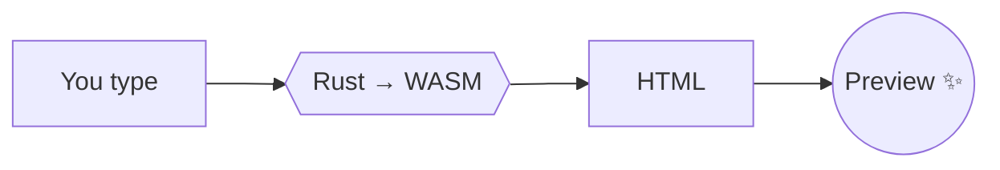

# Welcome to Inkwell :sparkles:

Inkwell is a Markdown editor that lives in your browser. Every keystroke is parsed by a **Rust** engine compiled to **WebAssembly**, so the preview updates as fast as you type. Check the ⚡ timer in the status bar.

> [!TIP]
> Type `/` at the start of a line to insert blocks, or `:` followed by a word for emoji (try `:rocket`). Press **Ctrl/⌘ + Shift + P** to search every command.

## Things to try

- [x] Open Inkwell
- [ ] Check this box in the **preview**. It updates the source too.
- [ ] Switch themes with the palette button (top right)
- [ ] Press **Alt + Z** for zen mode
- [ ] Check all the boxes for a surprise 🎉

## Text formatting

You can write **bold**, *italic*, ~~strikethrough~~, ==highlighted==, `inline code`, super^script^, and <kbd>Ctrl</kbd> + <kbd>K</kbd> keys. Bare links like https://www.rust-lang.org become clickable on their own, and emoji shortcodes such as :tada: :heart: :coffee: are converted.

Smart punctuation (enable it in Settings) turns "quotes" and -- dashes... into typographic ones.

## Lists

1. Ordered lists
2. Keep numbering for you
   - Press **Enter** to continue a list
   - **Tab** / **Shift+Tab** to indent

Term
: Definition lists are supported too.

## Code

```rust
/// The heart of Inkwell, simplified.
#[no_mangle]
pub extern "C" fn render(ptr: *const u8, len: usize) {
    let markdown = unsafe { std::str::from_utf8_unchecked(slice(ptr, len)) };
    let html = to_html(markdown);
    store(html);
}
```

```js
// Hover over a code block to copy it
const greet = (name) => `Hello, ${name}!`;
console.log(greet('Inkwell'));
```

## Tables

| Feature       | Supported | Notes                          |
| :------------ | :-------: | -----------------------------: |
| GFM tables    |     ✅     |    Press Ctrl+Shift+F to align |
| Task lists    |     ✅     |          Clickable in preview  |
| Math          |     ✅     |                Rendered by KaTeX |
| Diagrams      |     ✅     |                        Mermaid |
| Footnotes     |     ✅     |                   Like this[^1] |

## Math

Inline math like $e^{i\pi} + 1 = 0$ sits within the text, and display math gets its own line:

$$
\int_{-\infty}^{\infty} e^{-x^2}\,dx = \sqrt{\pi}
$$

## Diagrams



## Callouts

> [!NOTE]
> GitHub-style alerts work out of the box.

> [!WARNING]
> Documents are saved in this browser (IndexedDB). Use **Export → Back up all documents** now and then.

> [!IMPORTANT]
> Paste or drop images straight into the editor. They're stored locally and embedded when you export.

## Import & export

- **Import:** open `.md`, `.txt`, or `.html` files, drag & drop anywhere, import from a URL (GitHub links work), or paste rich text from any web page and it becomes Markdown.
- **Export:** Markdown, standalone HTML, PDF, Word, plain text, rich-text clipboard, or a full JSON backup.

<details>
<summary>Keyboard shortcuts</summary>

| Action | Shortcut |
| --- | --- |
| Command palette | Ctrl/⌘ + Shift + P |
| Bold / Italic | Ctrl/⌘ + B / I |
| Link | Ctrl/⌘ + K |
| Headings | Ctrl/⌘ + Alt + 1…6 |
| Cycle view | Ctrl/⌘ + \ |
| Find & replace | Ctrl/⌘ + F |
| New document | Alt + N |
| Zen mode | Alt + Z |

</details>

## Linking documents

Wiki-style links like [[My Next Idea]] open the document with that title, or create it if it doesn't exist yet.

---

Happy writing! :pencil2:

[^1]: Footnotes collect at the bottom of the page.
